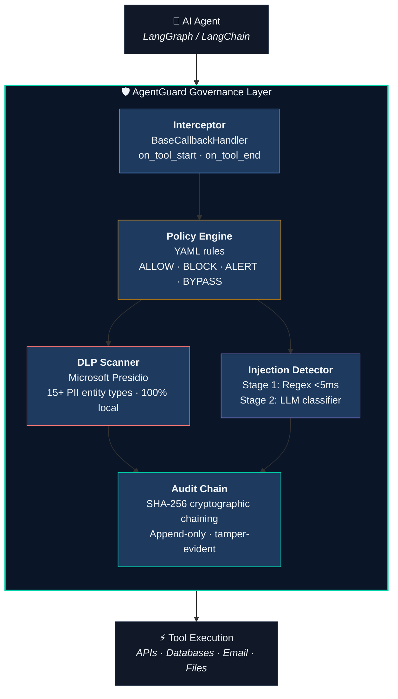

<p align="center">
  
</p>

<p align="center">
  <strong>The governance layer for LLM-powered AI agents.</strong><br/>
  A product by <a href="https://stridemap.ai">Stridemap Labs LLC</a> — Securing the Agentic Frontier.
</p>

<p align="center">
  <a href="https://github.com/stridemap/agentguard/actions/workflows/python-ci.yml"></a>
  <a href="https://github.com/stridemap/agentguard/actions/workflows/web-deploy.yml"></a>
  <a href="https://codecov.io/gh/stridemap/agentguard"></a>
  <a href="https://pypi.org/project/agentguard/"></a>
  <a href="https://pypi.org/project/agentguard/"></a>
  <a href="LICENSE"></a>
</p>

---

## Live Deployment

| Service | URL |
|---------|-----|
| **Website** | [stridemap.ai](https://stridemap.ai) |
| **Dashboard** | [stridemap.ai/dashboard](https://stridemap.ai/dashboard) |
| **API** | [api-production-13f3.up.railway.app](https://api-production-13f3.up.railway.app) |
| **API Docs** | [api-production-13f3.up.railway.app/docs](https://api-production-13f3.up.railway.app/docs) |

---

## Why AgentGuard?

AI agents are powerful — and ungoverned. They read emails, query databases, call APIs, and execute code. But nobody is watching what they do.

**AgentGuard** intercepts every tool call your AI agents make and enforces security policies — DLP scanning, prompt injection detection, and tamper-proof audit logging — **without changing a single line of your agent code**.

---

## 30-Second Quickstart

```bash
pip install agentguard
```

```python
from agentguard import AgentGuardInterceptor

# 2 lines. Zero agent code changes.
interceptor = AgentGuardInterceptor(
    policy_path="policies/default.yaml",   # YAML policy rules
    dlp_sensitivity="HIGH",                # PII scanning level
)

config = {"callbacks": [interceptor]}
agent.invoke(input, config=config)

# Every tool call is now governed:
#   ✓ Policy evaluated (ALLOW / BLOCK / ALERT / BYPASS)
#   ✓ PII scanned locally via Presidio
#   ✓ Prompt injection checked (regex + LLM)
#   ✓ Event logged to tamper-proof audit chain
```

---

## Architecture



---

## Five Core Modules

| Module | What It Does | Key Specs |
|--------|-------------|-----------|
| **Interceptor** | LangGraph `BaseCallbackHandler` — captures every `on_tool_start` / `on_tool_end` event | Fail-open guarantee · <5ms p50 overhead |
| **Policy Engine v2** | YAML-based rule evaluation with regex conditions, AND/OR logic, hot-reload | <5ms p99 · priority ordering |
| **DLP Scanner** | Microsoft Presidio PII detection — SSN, credit card, email, phone, medical license, and 10+ more | 100% local · zero data egress · <50ms/10KB |
| **Injection Detector** | Two-stage defense: 23 regex patterns (OWASP LLM01-06) + LLM classifier for edge cases | Precision >0.90 · recall >0.92 · Stage 1 <5ms |
| **Audit Chain** | SHA-256 cryptographic chaining — every event hash includes previous event hash | Tamper-evident · SOC2/HIPAA-ready · CLI verify |

---

## Full Feature Set (v2.0)

| Category | Features |
|----------|----------|
| **Core Governance** | Interceptor, Policy Engine v2, DLP Scanner, Injection Detector, Audit Chain |
| **REST API** | 40+ FastAPI endpoints, JWT auth, RBAC (admin/analyst/auditor), rate limiting |
| **Observability** | SIEM/CEF webhooks (Splunk/Datadog), Prometheus metrics, alert webhooks, Grafana template |
| **Enterprise Auth** | OIDC SSO (Okta/Azure AD), SAML 2.0 stub, refresh tokens, row-level tenant isolation |
| **Infrastructure** | Docker, Docker Compose, Helm chart (K8s), HPA autoscaling, Railway deployment |
| **Storage** | SQLite (dev) / PostgreSQL (prod), Redis queue, S3/GCS audit archival |
| **Multi-Agent** | Federation manager, distributed trace sessions, cross-agent call graphs, federation policies |
| **Compliance** | SOC2 CC6 / HIPAA §164.312 / ISO 27001 A.12.4 auto-populated reports, data retention |
| **Marketplace** | 5 community policy packs (PCI-DSS, SOX, HIPAA, Legal, IT Security) |
| **Dashboard** | Next.js 14 enterprise dashboard: live feed, audit viewer, policy manager, compliance exports |
| **SDK Adapters** | Native support for LangGraph, OpenAI Agents SDK, Anthropic Claude SDK, CrewAI, AutoGen |

---

## Project Structure

```
agentguard/          Core Python package (20+ modules)
api/                 FastAPI REST API (40+ endpoints, JWT, RBAC, SSO)
web/                 Next.js 14 frontend — stridemap.ai + enterprise dashboard
dashboard/           Streamlit trace viewer (MVP)
demo/                Runnable attack scenarios (PII_EXFIL, INJECT, UNAUTH)
policies/            YAML policy definitions + marketplace packs
tests/               pytest test suite — 399 tests, 82%+ coverage
helm/                Kubernetes Helm chart
alembic/             Database migrations
scripts/             K8s smoke tests
```

---

## Development

### Prerequisites

- Python 3.11+
- Node.js 18+ (for web frontend)
- Ollama with `llama3.2` (optional, for local LLM classifier)

### Setup

```bash
# Clone
git clone https://github.com/stridemap/agentguard.git
cd agentguard

# Python — install in dev mode
pip install -e ".[dev]"

# Web frontend
cd web && npm install
```

### Commands

```bash
# Lint
ruff check agentguard/ tests/
black --check agentguard/ tests/

# Test with coverage
pytest tests/ --cov=agentguard --cov-fail-under=80

# Run demos
python -m demo.finance_scenario
python -m demo.attack_scenarios

# Run API locally
uvicorn api.main:app --reload

# Verify audit chain
python -m agentguard verify-chain --db agentguard.db
```

---

## Deployment

### Cloud (Railway — Live)

The API is deployed at `https://api-production-13f3.up.railway.app` with PostgreSQL.

### Docker Compose

```bash
docker compose up -d
# API: http://localhost:8000  |  Dashboard: http://localhost:8501
```

### Kubernetes (Helm)

```bash
helm install agentguard ./helm/agentguard -f helm/agentguard/values-prod.yaml
```

---

## Roadmap

| Phase | Sprints | Status | Version |
|-------|---------|--------|---------|
| **MVP** | 1–4 | Done | — |
| **Governance Layer** | 5–8 | Done | v1.0.0 |
| **Pilot Ready** | 9–12 | Done | v1.5.0 |
| **Production Scale** | 13–16 | Done | v2.0.0 |
| **Runtime Security** | 17–24 | Future | v2.x |

---

## Contributing

We welcome contributions! See [ONBOARDING.md](ONBOARDING.md) for setup and [COMPATIBILITY.md](COMPATIBILITY.md) for framework integration guides.

1. **Fork** the repo and create a feature branch from `main`
2. **Install** dev dependencies: `pip install -e ".[dev]"`
3. **Write tests** — coverage must stay above 80%
4. **Lint**: `ruff check agentguard/ tests/ && black --check agentguard/ tests/`
5. **Submit a PR** with a clear description

### Reporting Issues

- Security vulnerabilities: email **security@stridemap.ai**
- Bugs and feature requests: [GitHub Issues](https://github.com/stridemap/agentguard/issues)

---

## License

Proprietary. Copyright (c) 2026 Stridemap Labs LLC. All rights reserved. See [LICENSE](LICENSE) for details.

---

<p align="center">
  <a href="https://stridemap.ai">Stridemap Labs</a> · <a href="https://github.com/stridemap/agentguard">GitHub</a> · <a href="mailto:support@stridemap.ai">support@stridemap.ai</a>
</p>
