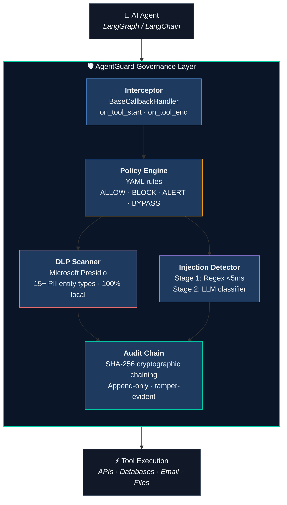

<p align="center">
  
</p>

<p align="center">
  <strong>The open-source governance layer for LLM-powered AI agents.</strong><br/>
  Think Palo Alto Prisma, but for AI agents.
</p>

<p align="center">
  <a href="https://github.com/stridemap/agentguard/actions/workflows/python-ci.yml"></a>
  <a href="https://github.com/stridemap/agentguard/actions/workflows/web-deploy.yml"></a>
  <a href="https://codecov.io/gh/stridemap/agentguard"></a>
  <a href="https://pypi.org/project/agentguard/"></a>
  <a href="https://pypi.org/project/agentguard/"></a>
  <a href="LICENSE"></a>
</p>

---

## Why AgentGuard?

AI agents are powerful — and ungoverned. They read emails, query databases, call APIs, and execute code. But nobody is watching what they do.

**AgentGuard** intercepts every tool call your AI agents make and enforces security policies — DLP scanning, prompt injection detection, and tamper-proof audit logging — **without changing a single line of your agent code**.

---

## 30-Second Quickstart

```bash
pip install agentguard
```

```python
from agentguard import AgentGuardInterceptor

# 2 lines. Zero agent code changes.
interceptor = AgentGuardInterceptor(
    policy_path="policies/default.yaml",   # YAML policy rules
    dlp_sensitivity="HIGH",                # PII scanning level
)

config = {"callbacks": [interceptor]}
agent.invoke(input, config=config)

# Every tool call is now governed:
#   ✓ Policy evaluated (ALLOW / BLOCK / ALERT / BYPASS)
#   ✓ PII scanned locally via Presidio
#   ✓ Prompt injection checked (regex + LLM)
#   ✓ Event logged to tamper-proof audit chain
```

---

## Architecture



---

## Five Core Modules

| Module | What It Does | Key Specs |
|--------|-------------|-----------|
| **Interceptor** | LangGraph `BaseCallbackHandler` — captures every `on_tool_start` / `on_tool_end` event | Fail-open guarantee · <5ms p50 overhead |
| **Policy Engine** | YAML-based rule evaluation with ALLOW / BLOCK / ALERT / BYPASS actions | Hot-reload · <5ms p99 · priority ordering |
| **DLP Scanner** | Microsoft Presidio PII detection — SSN, credit card, email, phone, medical license, and 10+ more | 100% local · zero data egress · <50ms/10KB |
| **Injection Detector** | Two-stage defense: fast regex patterns (OWASP LLM01-06) + LLM classifier for edge cases | Precision >0.90 · recall >0.85 · Stage 1 <5ms |
| **Audit Chain** | SHA-256 cryptographic chaining — every event hash includes previous event hash | Tamper-evident · SOC2/HIPAA-ready · CLI verify |

---

## Comparison

| Feature | AgentGuard | LangSmith | HiddenLayer | CalypsoAI |
|---------|:----------:|:---------:|:-----------:|:---------:|
| Open Source (MIT) | ✅ | ❌ | ❌ | ❌ |
| Tool-Call Interception | ✅ | ✅ | ❌ | ◐ |
| YAML Policy-as-Code | ✅ | ❌ | ❌ | ◐ |
| DLP / PII Scanning (Local) | ✅ | ❌ | ◐ | ✅ |
| Prompt Injection Detection | ✅ | ❌ | ✅ | ✅ |
| Cryptographic Audit Chain | ✅ | ❌ | ❌ | ❌ |
| Zero Agent Code Changes | ✅ | ✅ | ❌ | ❌ |
| Fail-Open Guarantee | ✅ | ❌ | ❌ | ❌ |
| Self-Hosted / VPC | ✅ | ◐ | ✅ | ❌ |

---

## Project Structure

```
agentguard/          Core Python package — interceptor, policy engine, DLP, injection, audit
web/                 Next.js 14 frontend — landing page (stridemap.ai) + enterprise dashboard
dashboard/           Streamlit real-time trace viewer (MVP)
demo/                Runnable attack scenario scripts (PII_EXFIL, INJECT, UNAUTH)
policies/            YAML policy definitions (default, finance, healthcare)
tests/               pytest test suite — 80% coverage minimum, performance assertions
docs/                PRD, architecture, system design, functional spec, test plan, sprint plan
.github/workflows/   CI pipelines — python-ci.yml (ruff + black + pytest) · web-deploy.yml
```

---

## Development

### Prerequisites

- Python 3.11+
- Node.js 18+ (for web frontend)
- Ollama with `llama3.2` (optional, for local LLM classifier)

### Setup

```bash
# Clone
git clone https://github.com/stridemap/agentguard.git
cd agentguard

# Python — install in dev mode
pip install -e ".[dev]"

# Web frontend
cd web && npm install
```

### Commands

```bash
# Lint
ruff check agentguard/ tests/
black --check agentguard/ tests/

# Test with coverage
pytest tests/ --cov=agentguard --cov-fail-under=80

# Test (skip slow LLM-dependent tests)
pytest tests/ -m "not slow"

# Run specific test module
pytest tests/test_interceptor.py -v

# Web dev server
cd web && npm run dev

# Streamlit dashboard
streamlit run dashboard/app.py

# Verify audit chain integrity
python -m agentguard verify-chain --db agentguard.db
```

### Environment Variables

Copy `.env.example` to `.env` and configure:

```bash
AGENTGUARD_LLM_PROVIDER=ollama          # ollama | openai | anthropic
AGENTGUARD_POLICY_PATH=policies/         # Path to YAML policy directory
AGENTGUARD_LOG_LEVEL=INFO                # DEBUG | INFO | WARNING | ERROR
DATABASE_URL=sqlite:///agentguard.db     # SQLite (dev) or PostgreSQL (prod)
```

---

## Roadmap

| Phase | Sprints | Theme | Milestone |
|-------|---------|-------|-----------|
| **MVP** | 1–4 | Foundation · Interceptor · Policy/DLP · Injection/Audit | Demo video + OSS launch |
| **Governance Layer** | 5–8 | FastAPI · PostgreSQL · SIEM · PyPI v1.0 | Production REST API |
| **Pilot Ready** | 9–12 | SSO/RBAC · Kubernetes · Next.js Dashboard | First pilot customer |
| **Production Scale** | 13–16 | Multi-tenant · Policy Marketplace · S3 archival | v2.0-alpha PyPI |
| **Runtime Security** | 17–24 | eBPF · seccomp · process isolation · network namespaces | v2.0 final |

See [`docs/AgentGuard_Sprint_Plan_v1.md`](docs/AgentGuard_Sprint_Plan_v1.md) for the full 24-sprint breakdown.

---

## Contributing

We welcome contributions! Here's how to get started:

1. **Fork** the repo and create a feature branch from `main`
2. **Install** dev dependencies: `pip install -e ".[dev]"`
3. **Write code** following the project conventions:
   - Type hints on all functions
   - Pydantic v2 for data models
   - Fail-open error handling in interceptor pipeline
   - Docstrings on public classes and methods
4. **Write tests** — coverage must stay above 80%
5. **Lint** before committing: `ruff check agentguard/ tests/ && black --check agentguard/ tests/`
6. **Submit a PR** with a clear description of what and why

### Commit Convention

```
<type>: <short description>

<optional body — explain why, not what>
```

Types: `feat`, `fix`, `test`, `docs`, `refactor`, `ci`, `chore`

### Reporting Issues

- Security vulnerabilities: email **security@stridemap.ai** (do not open a public issue)
- Bugs and feature requests: [GitHub Issues](https://github.com/stridemap/agentguard/issues)

---

## License

[MIT](LICENSE) — use it freely, commercially, wherever. Attribution appreciated.

---

<p align="center">
  <a href="https://stridemap.ai">stridemap.ai</a> · <a href="https://github.com/stridemap/agentguard">GitHub</a> · <a href="mailto:support@stridemap.ai">support@stridemap.ai</a>
</p>
