# MiniGate Architecture

**Stridemap Labs LLC** · Status: Phase 3 — remote HTTP gateway with OAuth passthrough; every MCP surface governed in both directions · Last updated 2026-08-10

MiniGate governs what AI agents may do, at the point of tool execution. It speaks the
Model Context Protocol on both sides: an MCP client connects to MiniGate, MiniGate
connects to the real MCP servers, and every message between them is subject to policy,
scanning, and a tamper-evident audit trail.

Governing at the protocol layer rather than inside an agent framework is the central
architectural bet. It makes MiniGate client- and framework-agnostic by construction —
Claude Desktop, Cursor, Claude Code, VS Code, Goose, or an agent built on any MCP client
library, whatever framework wrote it — with one implementation and no code change in the
agent. The cost of that bet, and what it deliberately gives up, is recorded in
[ADR-001](../docs/adr/001-no-model-channel-interception.md).

---

## 1. Design principles

**Protocol-layer governance.** One implementation covers every MCP client. No SDK
adoption, no per-framework work, no build-time integration.

**No key custody, no certificate.** MiniGate never holds a provider API key and never
asks for a root CA. This is a hard constraint, not a current limitation — see ADR-001.

**Fail open on faults, fail closed on policy.** If MiniGate's own machinery breaks, the
agent keeps working. If a rule says BLOCK, the call is blocked. These are different
failure modes and are handled differently.

**Both halves of enforcement.** Filtering the tool list without gating calls is
bypassable. Gating calls without filtering the list wastes context and produces
confusing failures. MiniGate does both.

**Audit is a product surface, not a log file.** Every decision lands in an append-only,
SHA-256-chained store. Any modification to any historical event is detectable.

**Verify what you were shown.** A tool's definition is only checkable where the server
advertises it. MiniGate never treats a matching *name* as evidence about a definition it
has not seen.

---

## 2. System architecture

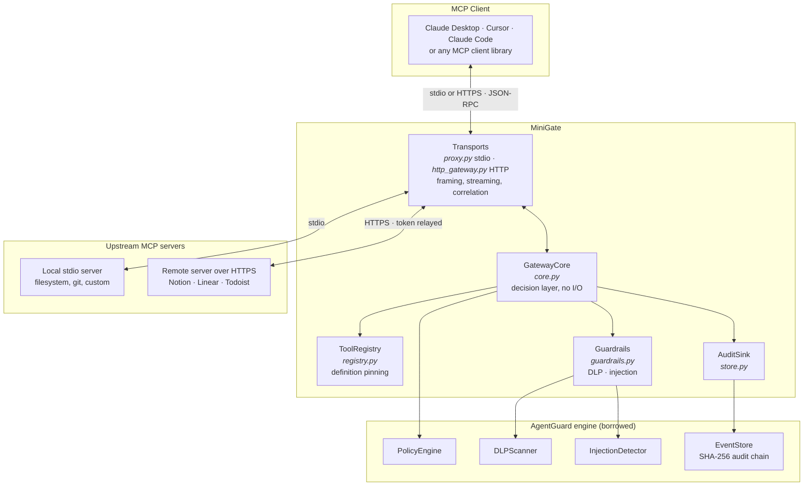

`GatewayCore` holds all decision logic and performs no I/O, so it is testable without
spawning a process or a server. Transports own framing and streaming and call into it.
That separation paid off exactly as intended when HTTP was added: the remote gateway
reuses the decision layer and the correlation router without a line of new policy logic,
which is what makes the two transports provably equivalent in what they enforce.

---

## 3. Component inventory

### Implemented

| Module | Responsibility |
|---|---|
| `core.py` | Decision layer: gates calls, filters lists, scans results |
| `proxy.py` | Stdio transport, two concurrent pumps, request/response correlation |
| `registry.py` | Approved-tool registry, canonical hashing, verdicts, diff |
| `lineage.py` | Trust levels, hash-only taint store, crossing detection |
| `discovery.py` | Minimal MCP client — handshake and paged `tools/list`, never calls a tool |
| `guardrails.py` | Fail-open facade over DLP and injection scanning |
| `models.py` | `McpEvent` — the framework-neutral event, plus the AgentGuard bridge |
| `config.py` | YAML configuration and per-server policy resolution |
| `store.py` | Audit sink over AgentGuard's non-blocking queue |
| `http_gateway.py` | Remote transport — Streamable HTTP, SSE governance, OAuth passthrough |
| `router.py` | Request/response correlation, shared by both transports |
| `logging.py` | Structured JSON logging, stderr only |
| `__main__.py` | CLI: `stdio`, `serve`, `snippet`, `verify`, `registry sync/diff/list` |

Every surface is governed by the one decision layer in `core.py`, addressed by tool name,
URI, prompt name, or method as the target requires. The two server-initiated methods —
sampling and elicitation — share the reverse-direction path: `on_server_request` answers
the server directly without the client ever seeing the message, and `on_client_response`
governs the reply on its way back out.

### Borrowed from AgentGuard

| Module | Used for | Modified |
|---|---|---|
| `policy_engine.PolicyEngine` | Rule evaluation | No |
| `dlp_scanner.DLPScanner` | PII detection and redaction | No |
| `injection_detector.InjectionDetector` | Prompt-injection scanning | No |
| `event_store` · `store_factory` | Append-only store, audit chain, async queue | No |
| `models.AgentEvent` | Persistence and policy target via `McpEvent.to_agent_event()` | No |

MiniGate consumes AgentGuard as a library. No AgentGuard module has been modified.

### Planned

| Component | Purpose | Phase |
|---|---|---|
| `discovery/idp.py` | Shadow-MCP discovery from Google Workspace / Okta grant logs | 4 |
| Local adapters | Tier-2 coverage for framework-native, non-MCP tools | On demand |

---

## 4. Enforcement points

| MCP method | Direction | Control | Status |
|---|---|---|---|
| `tools/list` | server → client | Policy-blocked tools stripped from the list | Shipped |
| `tools/list` | server → client | Definitions hashed against the approved registry | Shipped |
| `tools/list` | server → client | Descriptions scanned for hidden instructions | Shipped |
| `tools/call` | client → server | Policy evaluation on tool + arguments | Shipped |
| `tools/call` | client → server | Registry verdict enforced | Shipped |
| `tools/call` | client → server | DLP scan and redaction of arguments | Shipped |
| `tools/call` | server → client | DLP and injection scan of results | Shipped |
| `tools/call` | server → client | Result values tainted with the source's trust level | Shipped |
| `tools/call` | client → server | Arguments checked for trust-boundary crossings | Shipped |
| `resources/list` | server → client | Policy-blocked resources stripped; metadata scanned | Shipped |
| `resources/templates/list` | server → client | Template metadata scanned for hidden instructions | Shipped |
| `resources/read` · `resources/subscribe` | client → server | Policy evaluation on the URI | Shipped |
| `resources/read` | server → client | Content DLP- and injection-scanned, and tainted | Shipped |
| `prompts/list` | server → client | Policy-blocked prompts stripped; metadata and argument descriptions scanned | Shipped |
| `prompts/get` | client → server | Policy on the prompt, DLP on arguments, lineage check | Shipped |
| `prompts/get` | server → client | Expanded messages scanned; injected content replaced outright | Shipped |
| `sampling/createMessage` | **server → client** | Policy, includeContext ceiling, injection scan of the server's prompt | Shipped |
| `sampling/createMessage` reply | client → server | Completion DLP-scanned and lineage-checked before it leaves | Shipped |
| `elicitation/create` | **server → client** | Policy, sensitive-field refusal, injection scan of the message | Shipped |
| `elicitation/create` reply | client → server | What the user typed is DLP-scanned and lineage-checked | Shipped |
| `notifications/tools/list_changed` | server → client | Forwarded; re-filtered on the next list | Shipped |

**Why both `tools/list` and `tools/call`.** Filtering alone is bypassable — nothing in the
protocol stops a client calling a tool that was never listed. Gating alone burns context
and lets the model plan around tools it can never use, producing failures the user cannot
interpret. The two controls cover each other's gap.

---

## 5. Workflows

### 5.1 Session startup and tool filtering

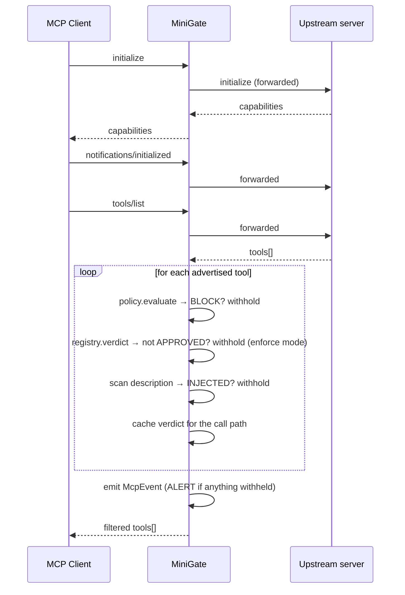

The model never learns that a withheld tool exists. Verdicts observed here are cached for
the session and are what the call path enforces against.

### 5.2 Tool call — allowed and blocked

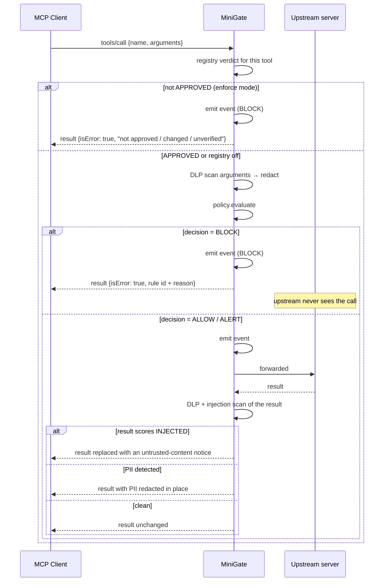

A block is returned as a JSON-RPC **result** carrying `isError: true`, never a
protocol-level error. A protocol error reads as a transport failure and the client may
retry or surface a broken-tool message; an error result lands in model context, so the
agent can explain the block to the user and choose another approach. The message names the
rule and the audit event id.

### 5.3 Resource access

Resources are the other way data enters model context — files, pages, documents — so they
get the same two-sided treatment as tools, addressed by URI instead of by name.

```mermaid
sequenceDiagram
    participant C as MCP Client
    participant M as MiniGate
    participant S as Upstream server

    C->>M: resources/list
    M->>S: forwarded
    S-->>M: resources[]
    loop each resource
        M->>M: policy on <server>.resource:<uri> → BLOCK? withhold
        M->>M: scan name/description → INJECTED? withhold
    end
    M-->>C: filtered resources[]

    C->>M: resources/read {uri}
    M->>M: policy on the URI
    alt BLOCK
        M-->>C: isError, "the resource was not read"
        Note over S: upstream never sees the request
    else ALLOW
        M->>S: forwarded
        S-->>M: contents[]
        M->>M: DLP + injection scan; taint for lineage
        alt content scored INJECTED
            M-->>C: contents replaced with an untrusted-content notice
        else
            M-->>C: contents, PII redacted if found
        end
    end
```

`resources/subscribe` is gated by the same rules as `resources/read`: a subscription is a
standing read delivered by `notifications/resources/updated`, so allowing one while
blocking the other would leave the door open.

### 5.4 Prompt expansion

Prompts are the sharpest surface in the protocol. A tool result is data the model reads;
a prompt's messages are inserted into the conversation as **authored turns**, which is a
strictly stronger trust position. Injected content there is replaced outright rather than
redacted in place.

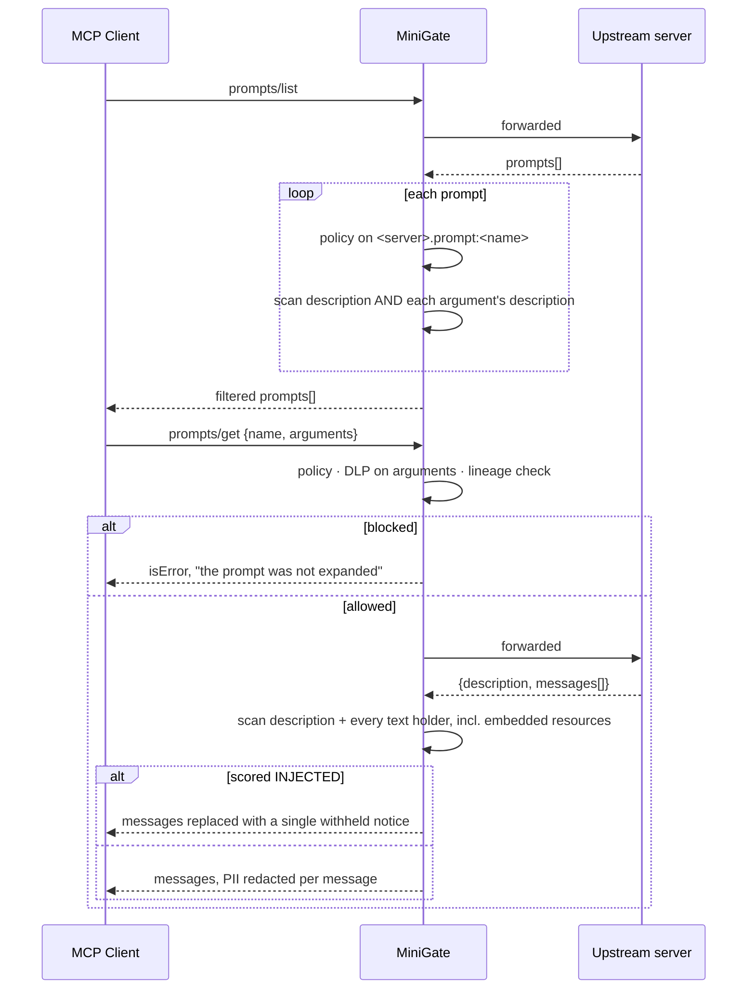

Argument descriptions are scanned alongside the prompt's own: they are equally
model-visible and server-controlled, and a description telling the model what to put in a
field is a natural place to hide an instruction. Text is collected from three shapes —
a content object, a content list, and an embedded resource one level deeper — because
text missed there reaches the model unscanned.

### 5.5 Server-initiated sampling

Everything above flows client-to-server. `sampling/createMessage` runs the other way: the
server asks the client to run an LLM. The server authors the prompt, spends the user's
tokens, and receives the completion — so a server that can sample can both instruct the
model and read what it produced.

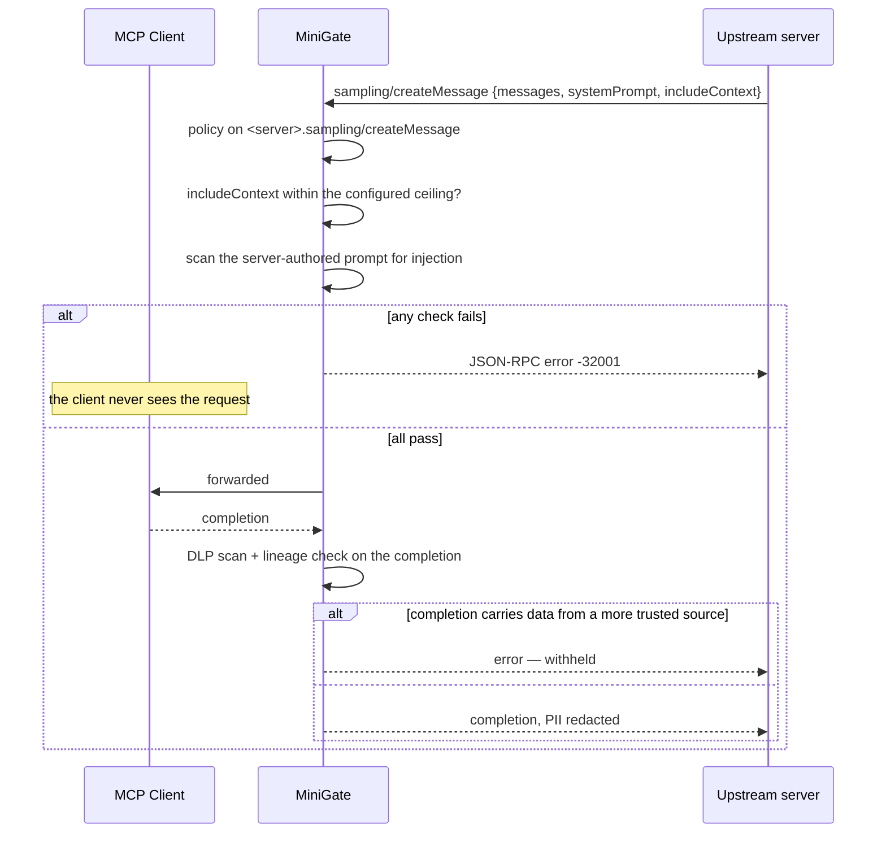

Rejection is a JSON-RPC **error**, not an error-carrying result. The requester here is the
server — software following the protocol, not a model reading context — so the protocol's
error channel is exactly right. That is the opposite of the tool-call case, where an error
result is preferred precisely because a model *will* read it.

Three checks, in order of bluntness:

1. **May this server sample at all?** Policy, on `<server>.sampling/createMessage`. The
   shipped rule `MG-050` denies it; enable per server with a scoped ALLOW.
2. **How much context may it pull in?** `includeContext: allServers` asks the client to
   attach context from *every* connected server and hand the result to the one that asked.
   The ceiling defaults to `thisServer`; an unrecognised value is rejected rather than
   waved through.
3. **Is the prompt it authored an injection?** The server writes both `systemPrompt` and
   the messages, so this is a direct attempt to steer the user's own model.

The reply is governed too. A completion is model output travelling to the server, which
makes it a data-egress channel — so DLP redacts it and lineage checks whether it carries
anything from a more trusted source.

### 5.6 Server-initiated elicitation

Elicitation is the only MCP channel that reaches the **human** directly. The server writes
the words the user reads and receives whatever they type back, so the threat is social
engineering rather than injection: a form headed "your session expired, confirm your
identity" that asks for a password harvests it straight from the person.

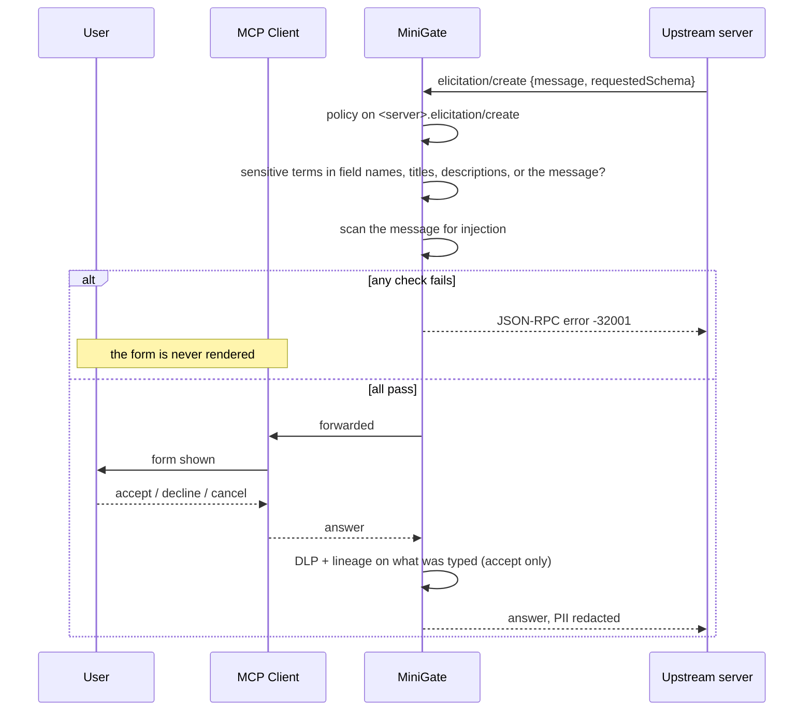

The MCP spec says servers MUST NOT use elicitation to request sensitive information. That
is an expectation of well-behaved servers; the sensitive-field check is what turns it into
something the client enforces.

**The check reads the whole form, not just field names.** A field called `value` with the
title "Your API key" asks for exactly the same thing, and a generic field paired with a
message saying "paste your MFA code" is the same attack again — so names, titles,
descriptions, enum options, and the message text are all folded into one pass.

Elicitation is allowed by policy (`MG-130`) because it is a legitimate UX feature: a server
asking which repository to use is ordinary. The layering is the point — policy permits the
channel, the sensitive-field check refuses the abuse of it.

### 5.7 Rug-pull detection

The attack a name-based policy cannot see: a tool passes review, then the server changes
its description or input schema. The name is unchanged, so `tool_name` rules still say
ALLOW — while the model is now reading different instructions and handing over different
data.

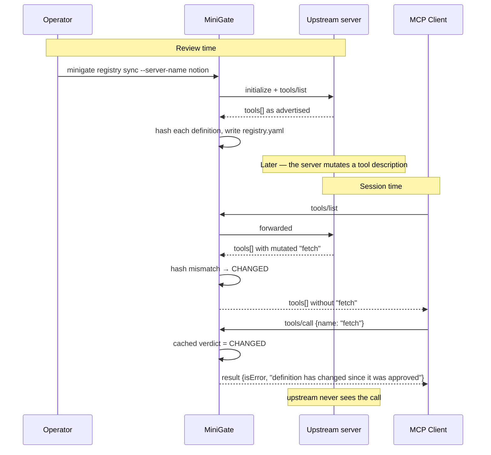

The whole tool object is hashed, not a chosen subset — any server-controlled field can
carry instructions, so a benign-looking addition still warrants re-approval.

### 5.8 Operator workflow — approving tools

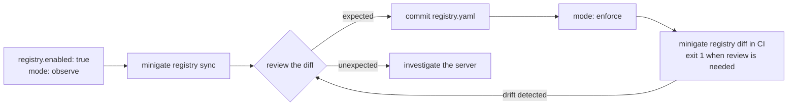

`observe` reports without withholding, so the registry can be populated against a working
setup. An empty registry in `enforce` mode denies everything — the correct direction for an
allowlist, and the reason `enforce` is not the default.

### 5.9 Trust-boundary crossing (lineage)

Per-call evaluation is structurally blind to this: an agent bulk-reads customer records
from a trusted source, then writes them into a public ticket. Each call is individually
permitted. Only the sequence is a breach.

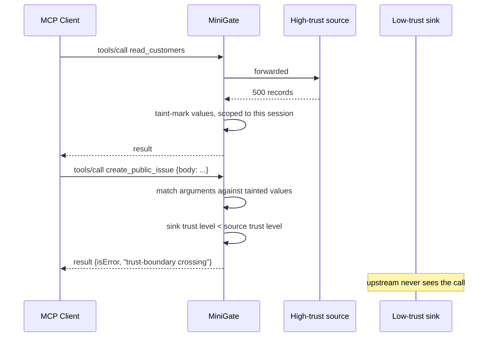

Two design decisions departed from the original sketch, both deliberately.

**Hashes only, no substring search.** A taint store holding raw customer records would be
a worse liability than the leak it prevents. Values are normalised and SHA-256 hashed on
the way in; outbound arguments are hashed the same way and compared. That rules out fuzzy
substring matching, so extraction runs several strategies instead — JSON leaves for
structured results, whole lines and quoted spans for prose, identifier-shaped tokens for
the account and contract references that survive an agent rewriting the sentence around
them, and the DLP scanner's entity matches. Line and quote extraction are skipped for payloads that parse as JSON: a fragment
like `"ok": true,` appears in almost any payload and would flag unrelated calls.

**The store is shared across processes, not scoped to a session.** Each MiniGate process
fronts one upstream server, so an in-process store could only ever observe same-server
flows — and the case worth catching is read-from-one, write-to-another. A SQLite store at
a shared path lets every MiniGate process on the machine contribute to the same lineage,
with a TTL bounding how long a value stays tainted.

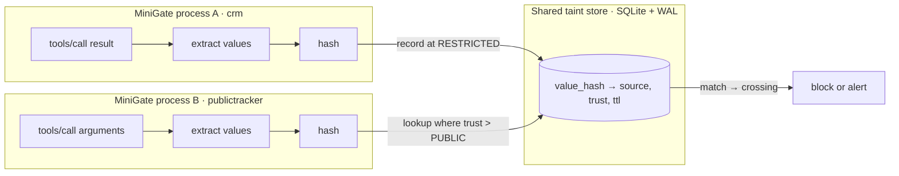

---

## 6. Data model

`McpEvent` is MiniGate's native event. It deliberately carries no callback-graph
assumptions — no `run_id`, no `parent_run_id` — which is what keeps it usable for any
client regardless of framework.

| Field | Notes |
|---|---|
| `event_id` · `timestamp` | UUID4, ISO 8601 UTC |
| `client_id` · `session_id` | Which client, which gateway process |
| `server` · `method` · `tool` | `server` is the configured name, not a URL |
| `direction` | `request` (leaving the model) or `response` (entering context) |
| `rpc_id` | Correlates the two halves of one call |
| `payload` · `payload_hash` | Redacted before storage if DLP matched |
| `policy_result` · `matched_rule` · `reason` | The decision and its justification |
| `dlp_entities` · `injection_status` · `registry_verdict` | What each control found |
| `lineage_sources` · `trust_level` | Where the data came from, and this sink's level |
| `filtered_tools` | Tools withheld on a `tools/list` |
| `latency_ms` | Governance overhead, not tool execution time |

**`qualified_tool`** is the policy-facing name: `<server>.<tool>`, or `<server>.<method>`
for non-tool methods. Qualifying by server is what lets one policy file govern many
servers without name collisions.

**The AgentGuard bridge.** `to_agent_event()` maps `McpEvent` onto `AgentEvent` so the
existing policy engine, audit chain, and dashboard work unchanged. The payload lands in
`input_str` for requests and `output_str` for responses, matching what AgentGuard's
`direction` conditions expect. Decision fields and PII risk flags are carried across — an
audit row recording that a call happened without recording whether it was allowed is not
an audit trail. This bridge is a compatibility layer; `McpEvent` is the direction of
travel.

**Audit chain.** Events are written through AgentGuard's background queue, so a tool call
never waits on disk I/O. Each event's hash chains to its predecessor; `minigate verify`
walks the chain and reports the first tampered event, if any.

---

## 7. Policy model

Rules are YAML, evaluated by AgentGuard's engine in priority order — lowest number first,
first match wins.

```yaml
- id: MG-020
  name: Notion is read-only
  priority: 20
  conditions:
    tool_name: "notion\\.notion-(create|update|move|duplicate)-.*"
  action: BLOCK
```

`tool_name` matches exact-or-regex against the qualified name. Conditions also cover
`data_pattern` (a DLP entity type), `direction`, `input_regex`, `output_regex`, and
`agent_id`, with `and` / `or` combination.

**Allowlist semantics.** The engine defaults to ALLOW when no rule matches, so a catch-all
deny at the lowest priority is what makes a policy an allowlist. Removing `MG-999` from the
shipped policy turns MiniGate into a monitor — useful while learning which tools your
agents actually use.

**Addressing resources.** Resources have URIs, not names, so they occupy their own slot
in the namespace: `<server>.resource:<uri>`. Rules match the URI directly, and a tool
named `notes.md` cannot be caught by a rule meant for a file of the same name.

```yaml
- id: MG-030
  name: Block credential and key material
  priority: 15
  conditions:
    tool_name: ".*\\.resource:.*(/\\.ssh/|/\\.aws/|id_rsa|\\.pem|credentials).*"
  action: BLOCK
```

Unlike tools, the shipped policy allows resources by default once the secret-path rules
have run (`MG-110`), because enumerating every legitimate URI in advance is impractical.
Deleting that rule makes resources an allowlist too, at the cost of authoring explicit
ALLOW rules — `MG-999` will otherwise deny them all.

Resource *templates* are not policy-filtered. A template like `file:///{path}` describes
a shape rather than a resource, so matching rules against it would block every template
or none; the concrete `resources/read` is where policy bites.

**Addressing prompts.** Prompts get their own slot too: `<server>.prompt:<name>`. This
matters more than it looks — `prompts/get` and `tools/call` both carry the target in
`params.name`, so without separate namespaces a rule written for a tool would silently
govern a prompt of the same name.

Prompts are allowed by default (`MG-120`), because they are user-initiated and few, and
blocking them by name is rarely the control you want. The real defence is scanning what
comes back.

**Verb matching.** Tool names vary in shape across servers: `fetch`, `read_file`,
`notion-fetch`. The shipped rules match a verb as a whole component anywhere in the name —
optional prefix ending in a separator, the verb, optional suffix starting with one.
Requiring a separator after the verb misses every bare-verb tool; requiring none matches
substrings inside unrelated words.

---

## 8. Registry model

| Verdict | Meaning | Enforced |
|---|---|---|
| `APPROVED` | Hash matches what was reviewed | Allowed |
| `CHANGED` | Server advertises something else under an approved name | Withheld and blocked |
| `UNKNOWN` | Never reviewed | Withheld and blocked |
| `UNVERIFIED` | Called without this session having seen it advertised | Blocked |

`UNVERIFIED` exists because a definition can only be verified where the server advertises
it. Treating a matching *name* as approved is exactly the check a rug-pull defeats, so an
unseen definition is never treated as approved. Every MCP client lists tools at session
start, so this costs nothing in practice.

Modes are `off`, `observe` (report only), and `enforce`.

### Lineage model

Trust levels are ordered, and the ordering is the whole contract: data may flow to equal
or higher trust, never downward.

| Level | Value | Typical |
|---|---|---|
| `PUBLIC` | 10 | Public issue trackers, outbound email, social |
| `INTERNAL` | 20 | Wikis, team chat — the default when unset |
| `CONFIDENTIAL` | 30 | Finance, HR, legal |
| `RESTRICTED` | 40 | Customer records, credentials, health data |

Declared per server, with per-tool overrides for a server that is both source and sink:

```yaml
servers:
  crm:
    trust: restricted
  linear:
    trust: internal
    tool_trust:
      create_public_issue: public
```

Because every server defaults to `INTERNAL`, an unconfigured deployment detects nothing.
That is intentional — the tracker should produce no findings until someone has said what
is sensitive, rather than inventing a hierarchy and generating noise.

Lineage runs after policy evaluation and only when the call would otherwise proceed, so an
explicit BLOCK keeps its own reason. In `observe` mode a crossing is recorded as `ALERT`;
in `enforce` it becomes `BLOCK`.

---

## 9. Failure semantics

| Failure | Behaviour | Rationale |
|---|---|---|
| Policy engine raises | Forward the call, log WARNING | MiniGate's fault must not break the agent |
| DLP scanner raises | Disable DLP for the process, log once | Presidio is optional and heavy; do not retry per call |
| Injection scanner raises | Skip the scan, log WARNING | Same |
| Lineage store raises | Report no crossing, log WARNING | A broken tracker must not break the agent |
| Audit store unavailable | Continue with a null sink, log WARNING | Losing a record is better than losing the session |
| Audit enqueue fails | Drop the event, log WARNING | The queue is bounded by design |
| Unparseable JSON-RPC line | Forward byte-for-byte | A shim that drops what it cannot parse breaks on the next protocol revision |
| Response with no matching request | Forward unfiltered | The gateway must not guess |
| Sampling or elicitation evaluation raises | Forward the request, log WARNING | Same fail-open rule, reverse direction |
| Rule evaluates to BLOCK | Block | Not a failure — the product working |

`fail_closed: true` inverts the first row only, for deployments that prefer an
unevaluable call to be denied. The response path always fails open: a broken gateway must
not strip content the agent already asked for.

---

## 10. Deployment topologies

### Shipped — stdio shim

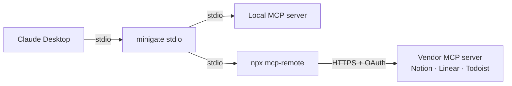

Configured in `claude_desktop_config.json`. Remote vendor servers are reached through
`mcp-remote`, which handles the OAuth flow itself — MiniGate sees plaintext JSON-RPC on the
pipe and never touches a token.

### Shipped — remote gateway

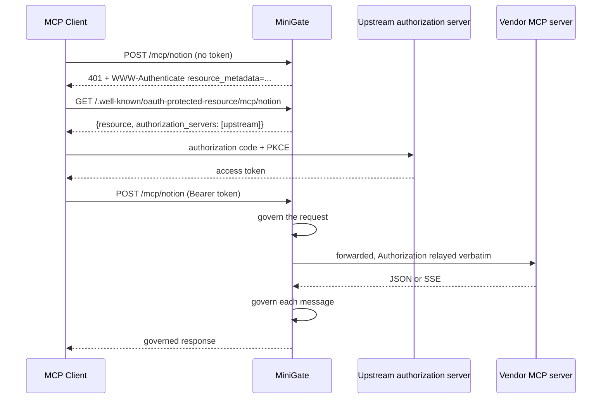

`minigate serve` fronts every server in the config that has a `url:`, each at its own path
and with its own policy and trust level. Responses arrive as either `application/json` or
`text/event-stream`; SSE is governed event by event as it passes rather than buffered,
since a gateway that waited for the whole stream would be indistinguishable from a slow
model.

**OAuth is passthrough.** MiniGate advertises the upstream's own authorization server and
relays the client's bearer token unchanged — it mints, stores, and refreshes nothing. The
reasoning and the audience-binding trade-off are recorded in
[ADR-002](../docs/adr/002-oauth-passthrough.md).

Not yet implemented: the optional `GET /mcp/{server}` server-to-client stream, which
returns 405 rather than 404 so a client can tell the endpoint apart from a missing route.
Server-initiated requests arriving on a POST response stream *are* governed — a rejected
one is dropped from the stream and its error POSTed back upstream, which is exactly what a
client would have sent.

---

## 11. Threat coverage

| Threat | Control | Status |
|---|---|---|
| Unsanctioned tool invoked | Policy allowlist + `tools/list` filtering | Shipped |
| Destructive operation | Policy rules on destructive verbs | Shipped |
| PII in tool arguments | DLP scan and redaction on the request path | Shipped |
| Tool poisoning — instructions in a description | Injection scan at list time | Shipped |
| Resource poisoning — instructions in resource metadata | Injection scan at list time | Shipped |
| Reading credentials or system files | Policy rules on resource URIs | Shipped |
| Injection via file or document content | Injection scan on `resources/read` | Shipped |
| Prompt poisoning — instructions in a prompt or argument description | Injection scan at list time | Shipped |
| Injected content expanded into conversation turns | Message scan on `prompts/get` | Shipped |
| Server jailbreaking the user's model via sampling | Injection scan of the server-authored prompt | Shipped |
| Cross-server context harvesting via `includeContext` | Configurable ceiling, default `thisServer` | Shipped |
| Data egress through a sampling completion | DLP and lineage on the reply | Shipped |
| Rug-pull — definition changed after approval | Registry pinning | Shipped |
| Indirect prompt injection in tool results | Injection scan on the response path | Shipped |
| PII returned into model context | DLP redaction on the response path | Shipped |
| Audit tampering | SHA-256 chained store, `minigate verify` | Shipped |
| Trust-boundary crossing across chained calls | Lineage tracker, shared taint store | Shipped |
| Credential phishing through an elicitation form | Sensitive-field refusal on names, titles, descriptions, and the message | Shipped |
| Data egress through what the user types | DLP and lineage on the elicitation reply | Shipped |
| Shadow MCP servers connected without oversight | IdP grant logs + endpoint config scan | Planned |
| Agent discloses data directly to the user | — | Out of scope — see ADR-001 |

---

## 12. Roadmap

| Phase | Scope | Status |
|---|---|---|
| 1 | Stdio gateway, list filtering, call gating, response scanning, audit | Shipped |
| 1.5 | Tool registry with definition pinning, `registry sync/diff/list` | Shipped |
| 1.6 | Lineage tracker — trust levels, shared taint store, crossing enforcement | Shipped |
| 1.7 | `resources/*` — list filtering, read gating, content scanning, lineage | Shipped |
| 1.8 | `prompts/*` — list filtering, get gating, message scanning, lineage | Shipped |
| 1.9 | `sampling/createMessage` — reverse-direction gating, completion egress control | Shipped |
| 2 | `elicitation/create` — credential-harvesting refusal, answer egress control | Shipped |
| 3 | Remote HTTP gateway — Streamable HTTP, SSE governance, OAuth passthrough | Shipped |
| 3.1 | GET server-to-client stream; session resumption | Next |
| 4 | Discovery via IdP grant logs and endpoint config scan | Planned |
| 5 | Tier-2 local adapters for non-MCP framework tools | On demand |
| — | Cooperative opt-in model proxy | Deferred — ADR-001 |
| — | TLS interception | Rejected — ADR-001 |

---

## 13. Known limitations

**Governance, not containment.** Anyone who can edit `claude_desktop_config.json` can point
it back at the raw server. MiniGate is enforcement for cooperative users plus tamper-evident
audit. Containment needs MDM-managed configuration, organisation-level connector
allowlists, or network egress control — and should be described that way to buyers.

**Anthropic-hosted connectors cannot be interposed.** Gmail, Google Calendar, and Google
Drive run in Anthropic's cloud with no endpoint to redirect. They can be disabled, or
replaced with a self-hosted MCP server behind MiniGate.

**The GET server-to-client stream is not proxied.** Server-initiated requests are governed
when they arrive on a POST response stream, which is the common case; a server that only
opens the standalone GET stream is not yet supported.

**Session resumption is not implemented.** `Last-Event-ID` is relayed but MiniGate keeps
no replay buffer, so a dropped SSE connection restarts rather than resumes.

**No model-channel visibility.** An agent that reads data through a governed tool and then
discloses it directly to the user is observed at the tool boundary but not at the point of
disclosure. This is a reporting gap rather than an enforcement one, and is a deliberate
consequence of ADR-001.

**Binary resource content is not scanned.** `resources/read` may return base64 `blob`
parts, which DLP and injection scanning cannot meaningfully inspect. Blobs are included in
lineage — a payload copied verbatim into a later call is still a flow — but their contents
are otherwise opaque.

**Lineage matches exact extracted values.** Because the store holds only hashes, a value
the agent paraphrases, translates, or summarises is not matched. Lineage catches
copy-through, which is the bulk-exfiltration shape; it is not a defence against a model
that deliberately restates data to evade it.

**Lineage needs trust levels to be declared.** Every server defaults to `INTERNAL`, so an
unconfigured deployment detects nothing. This is a deliberate no-noise default, not an
oversight — but it does mean the control is inert until configured.

### Known upstream issue

`agentguard.injection_detector`'s `dan_pattern` is
`(DAN|do\s+anything\s+now|jailbreak)\s*[:\-]?\s*` — no word boundaries, and the trailing
group matches empty, so it fires on the bare substring "dan". Ordinary content containing
*Dana*, *Daniel*, *abundant*, or *redundant* is classified `INJECTED` at 0.95 confidence,
which with `block_on_injected` withholds the tool result. Proposed fix: anchor the
alternation with word boundaries, e.g. `\b(DAN\b|do\s+anything\s+now|jailbreak)`. Per the
project's library-change policy this belongs in a separate change to `agentguard/` with a
regression test in `tests/`, not in a MiniGate commit.

---

## 14. Testing

266 tests in `tests/minigate/`, covering the decision layer, both transports,
configuration, the registry, lineage, and every governed MCP surface. Notable regression coverage, each
written after the bug was found:

- Response-path events must carry the tool name, or every successful call's result is
  caught by the allowlist's catch-all deny.
- The shipped policy must allow realistic tool-name shapes, parametrised over eleven of them.
- Policy decisions must survive the bridge into the audit chain.
- An approved *name* is not enough without a verified definition.
- JSON payloads must not be line-extracted for lineage, or syntax fragments become taint.
- The taint store must contain no raw values — asserted against the file's bytes.
- Identifiers must be extracted independently of the sentence around them, and bare
  dates and prose words must not be.
- `prompts/get` and `tools/call` both use `params.name`; correlation must not conflate them.
- Client-minted and server-minted request ids share a number space and must not collide.
- The client's Content-Length must not be relayed: the body is re-encoded after governance.
- Value selection under the extraction cap must be deterministic across hash seeds.

Verified end to end against real subprocesses: tool filtering, call blocking, tool-poisoning
detection, the rug-pull scenario with a properly sequenced client, cross-process
trust-boundary enforcement between two separately launched gateways, resource list
filtering with a blocked read never reaching upstream, prompt filtering on a poisoned
argument description, message replacement on an injected expansion, sampling rejected in
four configurations without the client ever seeing the request, credential-harvesting forms
refused before any human sees them, and audit chain integrity.

```bash
pytest tests/minigate/ -q
ruff check minigate/ tests/minigate/
```
