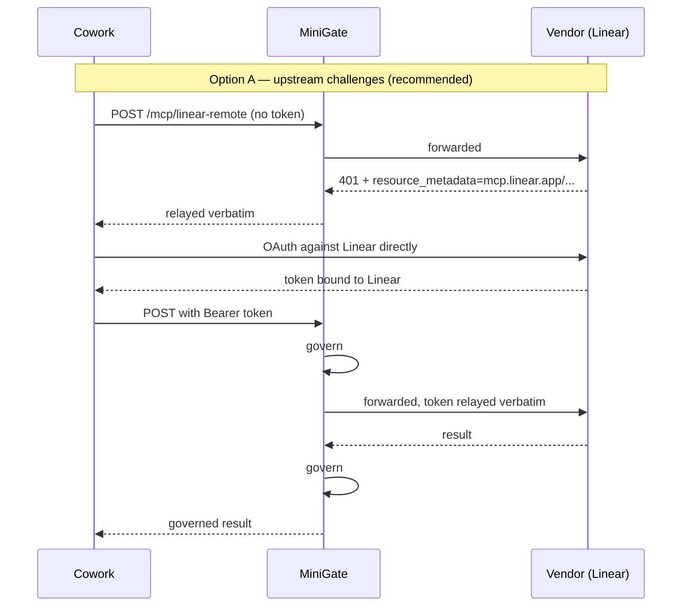

# MiniGate — Getting Started

A hands-on path from nothing to MiniGate governing your real Linear, Notion, and Todoist
connectors. Three stages, each useful on its own, each building on the last.

**Read this first.** Claude Cowork and claude.ai **cannot use local MCP servers**. Anthropic's
docs are explicit: `claude_desktop_config.json` servers "aren't available in Cowork or
claude.ai". Custom connectors are remote-only and are dialled **from Anthropic's cloud**, so
anything you want in the path has to be reachable over the public internet.

That means the stdio shim — the easy ten-minute install — is not available for Cowork. Fronting
Cowork requires Stage 3, `minigate serve` behind a public HTTPS URL. Stages 1 and 2 get you
real understanding first, with no tunnel and no exposure.

| Stage | What you learn | Cowork needed? | Public URL needed? | Time |
|---|---|---|---|---|
| **1. Inventory** | What Linear/Notion/Todoist actually expose, and what your policy would do | No | No | ~20 min |
| **2. Govern a client** | The full gateway in a real path, end to end | No (uses Claude Desktop or Claude Code) | No | ~30 min |
| **3. Front Cowork** | MiniGate as a custom connector | Yes | Yes | ~45 min |

---

## Stage 0 — Install

MiniGate needs **Python 3.11 or newer**. macOS ships 3.9 at `/usr/bin/python3` and the Xcode
Command Line Tools put another 3.9 on `PATH`, so a bare `pip install` usually picks the wrong
one and fails with:

```
ERROR: Package 'agentguard' requires a different Python: 3.9.6 not in '>=3.11'
```

That message means `pip` ran under 3.9, not that anything is wrong with the package. Never run
bare `pip` — always drive it through the interpreter you intend to use.

### 0.1 Find a suitable interpreter

```bash
for p in /opt/homebrew/bin/python3.1* /usr/local/bin/python3.1* \
         /Library/Frameworks/Python.framework/Versions/3.1*/bin/python3; do
  [ -x "$p" ] && echo "$p -> $($p -V 2>&1)"
done 2>/dev/null | sort -u
```

Pick any 3.11+. If nothing turns up, install one — `brew install python@3.13`, or the
installer from python.org.

### 0.2 Create a virtual environment

A venv keeps this off your system Python and puts the `minigate` command on `PATH`.

```bash
cd /path/to/sentinel
/usr/local/bin/python3.13 -m venv .venv        # substitute your interpreter
source .venv/bin/activate
python -V                                       # must report 3.11+
```

Once activated, `python` and `pip` both mean the venv. Every later command in this guide
assumes the venv is active — if you open a new terminal, `source .venv/bin/activate` again.

### 0.3 Install

```bash
python -m pip install --upgrade pip
python -m pip install -e ".[dev]"
```

Use `python -m pip`, not `pip`. The `-m` form guarantees the pip that belongs to the
interpreter you just checked, which is the whole point of the exercise.

This pulls Microsoft Presidio for PII detection, so the first install takes a few minutes.

### 0.4 Verify

```bash
minigate --version          # minigate 0.1.0
pytest tests/minigate/ -q   # 266 passed
```

If `minigate: command not found` but `python -m minigate --version` works, the console script
was not registered — re-run `python -m pip install -e ".[dev]"` inside the activated venv. That
happens when the package was installed before the entry point existed.

You also need Node, for the `mcp-remote` bridge that handles vendor OAuth:

```bash
node --version              # any recent LTS
```

> **Already have a venv for this repo?** Reuse it rather than building another — just re-run
> `python -m pip install -e ".[dev]"` inside it so the console scripts are current. Check what
> you have with `find . -name pyvenv.cfg -not -path "*/node_modules/*"`.

---

## Stage 1 — See what your connectors actually expose

**Goal:** a per-tool inventory of Linear, Notion, and Todoist, with the verdict your policy
would give each one. No client involved, nothing exposed to the internet.

### 1.1 How the vendor connection works

MiniGate speaks stdio. The vendors speak remote HTTP with OAuth. `mcp-remote` bridges the two:
it opens a browser for you to log in, caches the token under `~/.mcp-auth/`, and then relays
JSON-RPC over stdio. MiniGate sits on that stdio pipe and never touches your token.

```
minigate  ──stdio──►  npx mcp-remote  ──HTTPS + OAuth──►  https://mcp.linear.app/mcp
```

These three endpoints are live and verified as of today:

| Server | Endpoint |
|---|---|
| Linear | `https://mcp.linear.app/mcp` |
| Notion | `https://mcp.notion.com/mcp` |
| Todoist | `https://ai.todoist.net/mcp` |

> Linear's endpoint is `/mcp`, not `/sse` — `/sse` returns 404.

### 1.2 Authorise once per vendor

Run the bridge on its own first, so the browser flow is out of the way before MiniGate is in
the picture. A separate login window opens; approve it, then `Ctrl-C`.

```bash
npx -y mcp-remote https://mcp.linear.app/mcp
npx -y mcp-remote https://mcp.notion.com/mcp
npx -y mcp-remote https://ai.todoist.net/mcp
```

Tokens are cached, so subsequent runs are silent. If a login loops or fails, clear the cache
and retry: `rm -rf ~/.mcp-auth`.

### 1.3 Inventory each server

```bash
minigate tools --server-name linear -- npx -y mcp-remote https://mcp.linear.app/mcp
```

This performs the MCP handshake, reads `tools/list`, and exits. **It never calls a tool**, so
running it against a server you have not reviewed is safe.

With no policy it simply lists what is there. Add the shipped policy to see enforcement:

```bash
minigate tools --server-name linear --policy policies/minigate.yaml \
  -- npx -y mcp-remote https://mcp.linear.app/mcp
```

Output looks like this:

```
linear — 6 tools advertised

  VERDICT   TOOL                WHY
  --------- ------------------- ----------------------------------------
  BLOCK     create_attachment   MG-999
  BLOCK     delete_issue        MG-010
  FLAGGED   summarize           description scored INJECTED
  ALLOW     get_issue           MG-100
  ALLOW     list_issues         MG-100
  ALLOW     save_issue          MG-101

  3 exposed to the model · 3 withheld · 1 flagged as poisoned
```

Repeat for `notion` and `todoist`. Use `--json` if you want to diff or script it.

### 1.4 Read the result

Three things to look at:

**`BLOCK … MG-999`** — the tool matched no allow rule and hit the catch-all deny. The shipped
policy is an allowlist, so anything it does not recognise is withheld. This is the number to
tune: too many blocks means the policy needs rules for how *your* servers name things.

**`BLOCK … MG-010`** — a destructive verb matched an explicit rule. This is the policy doing
what you asked.

**`FLAGGED`** — a tool description contains something that scores as prompt injection. Read
that description yourself. On a real vendor server this is usually a false positive worth
investigating; on an unknown server it is the finding.

### 1.5 Tune the policy

Copy the shipped policy and edit rather than editing in place:

```bash
cp policies/minigate.yaml policies/mine.yaml
```

To allow a tool the catch-all is blocking, add a rule **above** priority 999:

```yaml
  - id: MY-010
    name: Allow Linear issue and comment management
    priority: 90
    conditions:
      tool_name: "linear\\.(list_|get_|search_|save_).*"
    action: ALLOW
```

Re-run `minigate tools --policy policies/mine.yaml` and watch the verdicts change. Iterate here
until the inventory looks right — it costs nothing and touches no live system.

> To start permissive instead, delete rule `MG-999`. The engine defaults to ALLOW when nothing
> matches, so removing the catch-all turns MiniGate into a monitor. Add it back when you are
> ready to enforce.

**Stage 1 is complete when** you can explain, for each of the three servers, which tools your
policy exposes and why.

---

## Stage 2 — Put MiniGate in a real path

**Goal:** watch the gateway govern a live session. Cowork cannot do this, but **Claude Desktop
and Claude Code both support local MCP servers**, so use one of them as the test client. What
you learn transfers directly to Stage 3, because both transports share one decision layer.

### 2.1 Write a config

```bash
cp minigate.example.yaml minigate.yaml
```

Edit it down to what you are testing:

```yaml
client_id: claude-desktop
policy: policies/mine.yaml
database_url: minigate.db

servers:
  linear:
    command: ["npx", "-y", "mcp-remote", "https://mcp.linear.app/mcp"]
    trust: internal
  notion:
    command: ["npx", "-y", "mcp-remote", "https://mcp.notion.com/mcp"]
    trust: internal
  todoist:
    command: ["npx", "-y", "mcp-remote", "https://ai.todoist.net/mcp"]
    trust: internal
```

### 2.2 Generate the client config

```bash
minigate snippet --server-name linear --config minigate.yaml
```

Paste the printed block into `~/Library/Application Support/Claude/claude_desktop_config.json`,
repeating per server, then restart the client.

**Then remove Linear from Settings → Connectors.** If the directory connector stays enabled,
the client will use it and route around MiniGate entirely. This is the single most common
setup mistake.

### 2.3 Verify from the client side

In Claude Desktop, ask it to list its Linear tools. You should see only what Stage 1 said would
be exposed. Then ask it to do something the policy blocks — deleting an issue, say. You should
get a refusal naming the rule, and the upstream never sees the call.

### 2.4 Look at the evidence

```bash
minigate verify --database minigate.db
sqlite3 minigate.db "select agent_id, tool_name, policy_result from events order by rowid desc limit 20"
```

Every decision, with the rule that produced it, in a chain where tampering is detectable.

### 2.5 Turn on the registry

Now pin what you reviewed:

```bash
minigate registry sync --server-name linear --config minigate.yaml --approved-by praveen
minigate registry list --config minigate.yaml
```

Then set `registry: { enabled: true, mode: observe }` in `minigate.yaml` and restart the client.
Observe mode reports without withholding. Once the log is quiet, switch to `enforce`.

From then on, this is your drift check — it exits non-zero when a vendor changes a tool:

```bash
minigate registry diff --server-name linear --config minigate.yaml
```

**Stage 2 is complete when** you have seen a call blocked from inside a real client and found
the corresponding row in the audit chain.

---

## Stage 3 — Front Cowork

**Goal:** MiniGate as a custom connector in Cowork, governing Linear, Notion, and Todoist.

This stage has more moving parts than the first two, because three separate things have to line
up: network reachability, the OAuth handshake, and the connector configuration. Take them one at
a time and verify each before moving on — almost every failure here is one of the three, and
they are easy to tell apart once you know what to look for.

### 3.1 What Cowork actually requires

Cowork dials your connector **from Anthropic's cloud**, not from your laptop. That single fact
drives everything else:

- The URL must resolve and be reachable from the public internet.
- It must be **HTTPS** with a certificate a server will accept — self-signed will not do.
- It must not sit behind a VPN, or a firewall that blocks Anthropic's ranges.
- Your machine being able to reach it proves nothing.

One MiniGate process fronts all three vendors, each at its own path. So you run one gateway and
add **three** custom connectors, differing only in the last path segment.

```
                                     ┌─► https://mcp.linear.app/mcp
Cowork ──HTTPS──► your-host/mcp/… ───┼─► https://mcp.notion.com/mcp
        (3 connectors)   MiniGate    └─► https://ai.todoist.net/mcp
```

### 3.2 Decide who issues the auth challenge

This is the most important decision in Stage 3, and the one that determines whether OAuth works
on the first try. MiniGate never mints or stores a token either way — the question is only
*which side tells the client where to authenticate.*

**Option A — let the upstream challenge (`auth.require: false`). Recommended.**

MiniGate forwards the unauthenticated request, the vendor answers `401`, and MiniGate relays
that challenge verbatim. Verified against Linear:

```
POST /mcp/linear-remote            (no token)
→ HTTP/1.1 401 Unauthorized
  www-authenticate: Bearer realm="OAuth",
    resource_metadata="https://mcp.linear.app/.well-known/oauth-protected-resource/mcp"
```

The client is sent to **Linear's** metadata, so the token it obtains is audience-bound to
Linear's own resource identifier — and is therefore accepted when MiniGate relays it. The
audience problem never arises.

**Option B — MiniGate challenges (`auth.require: true`).**

```
POST /mcp/linear-remote            (no token)
→ HTTP/1.1 401 Unauthorized
  www-authenticate: Bearer resource_metadata="https://your-host/.well-known/oauth-protected-resource/mcp/linear-remote"
```

The client binds its token to **MiniGate's** resource identifier. A vendor that validates token
audience strictly may then reject the relayed token. Use this when the upstream has no
authorization of its own, or when you want unauthenticated traffic rejected before it costs a
round trip upstream.



**Start with Option A.** If a vendor turns out not to challenge at all, switch that server to
Option B.

### 3.3 Write the remote config

Remote entries use `url:` instead of `command:`. A server has exactly one upstream, so add these
alongside your stdio entries under different names.

```yaml
client_id: cowork
policy: policies/mine.yaml
database_url: minigate.db

http:
  host: 127.0.0.1              # bind locally; the tunnel or reverse proxy owns TLS
  port: 8787
  public_url: https://YOUR-PUBLIC-HOST     # fill in after 3.4, then restart
  upstream_timeout_seconds: 120
  auth:
    mode: passthrough
    require: false             # Option A — let the vendor challenge

servers:
  linear-remote:
    url: https://mcp.linear.app/mcp
    authorization_servers: ["https://mcp.linear.app"]
    trust: internal
  notion-remote:
    url: https://mcp.notion.com/mcp
    authorization_servers: ["https://mcp.notion.com"]
    trust: internal
  todoist-remote:
    url: https://ai.todoist.net/mcp
    authorization_servers: ["https://ai.todoist.net"]
    trust: internal
```

Those issuer values are the vendors' own. Each already advertises `resource_metadata` at
`https://<host>/.well-known/oauth-protected-resource/mcp`, which is what MiniGate mirrors.

Bind to `127.0.0.1`, not `0.0.0.0`. Let the tunnel or reverse proxy terminate TLS and be the only
thing listening publicly.

### 3.4 Run it, then expose it

Start the gateway. It runs in the foreground and logs to stderr:

```bash
minigate serve --config minigate.yaml
# in another shell:
curl -s http://127.0.0.1:8787/healthz
# {"status":"ok","servers":["linear-remote","notion-remote","todoist-remote"],"auth_mode":"passthrough"}
```

Then expose it. Pick by intent:

| Option | Command | Good for | Watch out |
|---|---|---|---|
| **cloudflared** | `cloudflared tunnel --url http://localhost:8787` | Trying it today | URL changes on every restart — update `public_url` and restart `serve` |
| **ngrok** | `ngrok http 8787` | Trying it today | Same; free tier adds an interstitial that can break non-browser clients |
| **Named tunnel** | `cloudflared tunnel run <name>` | Repeated evaluation | Stable hostname; needs a Cloudflare-managed domain |
| **Cloud host** | Caddy or nginx in front of `serve` | Anything beyond evaluation | You own certificates, restarts, and patching |

For evaluation, cloudflared is the shortest path:

```bash
cloudflared tunnel --url http://localhost:8787
# note the https://<random>.trycloudflare.com URL it prints
```

Now put that URL into `public_url` and **restart `serve`** — it is read at startup. This is the
step people miss; discovery keeps advertising `127.0.0.1` until you do.

### 3.5 Verify each layer before touching Cowork

Run these against the **public** URL. Each isolates one thing.

```bash
HOST=https://YOUR-PUBLIC-HOST

# 1 — reachable and serving the right config
curl -s $HOST/healthz

# 2 — discovery metadata resolves and names the vendor's issuer
curl -s $HOST/.well-known/oauth-protected-resource/mcp/linear-remote | python3 -m json.tool

# 3 — the auth challenge (this 401 is success, not failure)
curl -s -D - -o /dev/null -X POST $HOST/mcp/linear-remote \
  -H 'Content-Type: application/json' \
  -H 'Accept: application/json, text/event-stream' \
  -d '{"jsonrpc":"2.0","id":1,"method":"initialize","params":{"protocolVersion":"2025-06-18","capabilities":{},"clientInfo":{"name":"probe","version":"1"}}}' \
  | grep -iE '^HTTP|www-authenticate'
```

What good looks like:

| Check | Expected |
|---|---|
| 1 | `{"status":"ok","servers":[…three…],"auth_mode":"passthrough"}` |
| 2 | `"resource"` is your **public** URL, `"authorization_servers"` is the vendor's |
| 3 | `401` with `www-authenticate` naming **`mcp.linear.app`** under Option A |

If check 2 still shows `127.0.0.1`, `public_url` is unset or `serve` was not restarted.

### 3.6 Add the connectors in Cowork

Settings → **Customize → Connectors → + → Add custom connector**. Once per server:

| Name | URL |
|---|---|
| `Linear (MiniGate)` | `https://YOUR-PUBLIC-HOST/mcp/linear-remote` |
| `Notion (MiniGate)` | `https://YOUR-PUBLIC-HOST/mcp/notion-remote` |
| `Todoist (MiniGate)` | `https://YOUR-PUBLIC-HOST/mcp/todoist-remote` |

Cowork will follow the 401, read the metadata, send you to the vendor's own login, and return
with a token. The consent screen you see is the vendor's — MiniGate is not in it, because it
issues nothing.

**Then disable the stock Linear, Notion, and Todoist connectors.** With both enabled, Cowork has
two routes to the same tools and may take the ungoverned one. This is the mistake that makes
people conclude MiniGate is not working.

### 3.7 Watch it work

Leave a log tail running while you use Cowork:

```bash
MINIGATE_LOG_LEVEL=INFO minigate serve --config minigate.yaml 2>&1 | grep -v '"level":"DEBUG"'
```

Then ask Cowork to list its Linear tools, and to do something the policy blocks. After a few
interactions:

```bash
minigate verify --database minigate.db
sqlite3 minigate.db \
  "select agent_id, tool_name, policy_result from events order by rowid desc limit 20"
```

You should see `agent_id` of `cowork`, the tools it actually used, and a `BLOCK` row for the
thing you asked it not to do.

**Stage 3 is complete when** Cowork lists tools through MiniGate, a blocked call is refused, and
both appear in the audit chain.

### 3.8 When it does not work

| Symptom | Likely cause | What to do |
|---|---|---|
| Cowork: cannot reach the server | Not publicly reachable, or TLS not trusted | Re-run 3.5 check 1 from a network that is not yours — a phone on cellular is a good test |
| Discovery shows `127.0.0.1` | `public_url` unset, or `serve` not restarted after setting it | Set it, restart |
| OAuth loops, or the token is rejected after login | Audience binding — the client bound the token to MiniGate | Switch that server to `auth.require: false` so the vendor issues the challenge (§3.2) |
| Connects, but no tools appear | Policy is withholding everything | `minigate tools --server-name linear-remote --config minigate.yaml` — the same verdicts apply here |
| Nothing in `minigate.db` | The stock connector is still enabled | Disable it in Settings → Connectors |
| Works, then stops after a while | Tunnel URL changed on restart | Use a named tunnel, or update `public_url` and restart |
| `405` in the logs for `GET /mcp/…` | Expected — MiniGate does not proxy the optional server-to-client stream | Harmless; the spec allows `405` and clients fall back to POST. If a client treats it as fatal, that is a real gap — tell me |

### 3.9 Before you leave it running

Evaluation setups have a habit of becoming permanent. Three things worth doing now:

- **Never set `auth.mode: none` on a public URL.** That accepts every request from anyone who
  finds the hostname. It exists for localhost work only.
- **Take the tunnel down when you are done.** A `trycloudflare.com` hostname is unauthenticated
  infrastructure pointed at your vendor tokens' relay path.
- **Treat `minigate.db` as sensitive.** It records tool names, arguments, and decisions. PII is
  redacted before storage when DLP is on, but the operational picture is still real.

## Where to go next

Once the three connectors are governed, the things worth turning on, in order:

1. **Registry enforce** — pins tool definitions so a vendor changing a tool after your review is
   refused. This is the control OWASP explicitly recommends for MCP.
2. **Lineage** — set `trust:` per server so a public tracker is `public` and anything with
   customer data is `restricted`, then run `mode: observe` for a week before enforcing.
3. **Sampling and elicitation** — already denied and screened by the shipped defaults; read what
   they log.

Scenario-by-scenario walkthroughs: [DEMO.md](DEMO.md).
Control detail and workflows: [ARCHITECTURE.md](ARCHITECTURE.md).

---

## Troubleshooting

| Symptom | Cause | Fix |
|---|---|---|
| `minigate tools` hangs | The OAuth browser flow is waiting | Run `npx mcp-remote <url>` alone first |
| Every tool shows `BLOCK … MG-999` | The allowlist doesn't match this server's naming | Add ALLOW rules above priority 999, or delete MG-999 to monitor first |
| Client shows tools MiniGate should hide | The stock connector is still enabled | Disable it in Settings → Connectors |
| `Upstream server did not respond to initialize` | Wrong URL, or the token expired | Verify the endpoint; `rm -rf ~/.mcp-auth` and re-authorise |
| Cowork won't connect | Not publicly reachable, or no valid TLS | Check the tunnel; Cowork dials from Anthropic's cloud, not your machine |
| `401` from your own gateway on curl | Working as intended | That is the auth challenge; only a real client completes the flow |
| Nothing in `minigate.db` | Calls are routing around the gateway | Confirm the client config points at `minigate`, and the stock connector is off |
